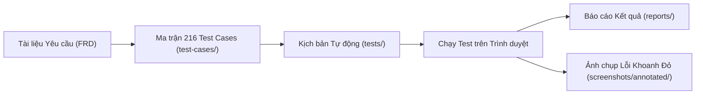

# DCOR Studio - Automation Testing Framework

Thư mục này chứa toàn bộ kịch bản kiểm thử tự động, tài liệu Test Case (Happy Path & Edge Cases phủ kín), dữ liệu mẫu, công cụ chụp/đánh dấu ảnh lỗi và báo cáo kiểm thử dành cho toàn bộ hệ thống Quản trị DCOR Studio.

---

## 📁 Cấu trúc Thư mục

```text
Automation-test/
├── configs/                 # File cấu hình môi trường (local vs dev), trình duyệt, viewport
├── test-cases/              # TÀI LIỆU MA TRẬN TEST CASE (CHUẨN QA/QC - PHỦ KÍN 100% EDGE CASES)
│   ├── 01_reports/          # 67 Test Cases cho 5 trang Báo cáo & Dashboard
│   ├── 02_inventory_product/# 95 Test Cases cho Khách hàng, Sản phẩm & 5 trang Tồn kho
│   └── 03_orders_warranty/  # 54 Test Cases cho Đơn hàng, May đo, Đổi trả, Bảo hành & Cài đặt
├── tests/                   # Mã nguồn kịch bản test tự động (Playwright / Puppeteer script)
│   ├── 01_reports/          # Test scripts Dashboard & Reports
│   ├── 02_inventory_product/# Test scripts Inventory & Products
│   └── 03_orders_warranty/  # Test scripts Orders & Warranty
├── pages/                   # Page Object Model (POM) khai báo bộ chọn & thao tác từng trang
├── fixtures/                # Dữ liệu kiểm thử mẫu (JSON)
├── utils/                   # Công cụ hỗ trợ: điều khiển trình duyệt, chụp ảnh, vẽ khoanh đỏ chú thích lỗi
├── reports/                 # Báo cáo kết quả kiểm thử dạng Markdown / HTML
└── screenshots/             # Bằng chứng hình ảnh kiểm thử
    ├── raw/                 # Ảnh chụp màn hình nguyên bản (pass / fail)
    └── annotated/           # Ảnh bằng chứng lỗi ĐÃ KHOANH ĐỎ kèm mã nhãn [BUG-xx]
```

---

## 📊 Tổng Hợp Toàn Bộ 216 Test Cases Toàn Hệ Thống (Phủ Kín Edge Cases)

| Phân hệ / Nhóm kiểm thử | Các màn hình chi tiết | Số lượng Test Case | Thư mục Test Case |
| :--- | :--- | :---: | :--- |
| **01. Dashboard & Báo cáo** | Tổng quan, Doanh thu, Đơn hàng, Sản phẩm, Khách hàng (5 trang) | **67** Test Cases | [`test-cases/01_reports/`](file:///d:/00_LEARNING/0_Study/HocChinhUEL/4_1_LapTrinhWebNangCao/DoAn/Dev/dcor_Angular/Automation-test/test-cases/01_reports/README.md) |
| **02. Khách hàng, Sản phẩm & Tồn kho** | Khách hàng, Sản phẩm, Danh mục, Tổng quan kho, Kiểm kê, Nhập xuất, Lịch sử, Cài đặt kho (8 trang) | **95** Test Cases | [`test-cases/02_inventory_product/`](file:///d:/00_LEARNING/0_Study/HocChinhUEL/4_1_LapTrinhWebNangCao/DoAn/Dev/dcor_Angular/Automation-test/test-cases/02_inventory_product/README.md) |
| **03. Đơn hàng, May đo & Hậu mãi** | Đơn hàng, May đo custom, Đổi trả 72h, Bảo hành điện tử, Cài đặt đơn (5 trang) | **54** Test Cases | [`test-cases/03_orders_warranty/`](file:///d:/00_LEARNING/0_Study/HocChinhUEL/4_1_LapTrinhWebNangCao/DoAn/Dev/dcor_Angular/Automation-test/test-cases/03_orders_warranty/README.md) |
| **TỔNG CỘNG TOÀN BỘ 18 TRANG** | **Toàn bộ hệ thống Quản trị DCOR Studio** | **216** Test Cases | **Đã hoàn tất 100%** |

---

## 🎯 Quy trình Kiểm thử Khép kín


