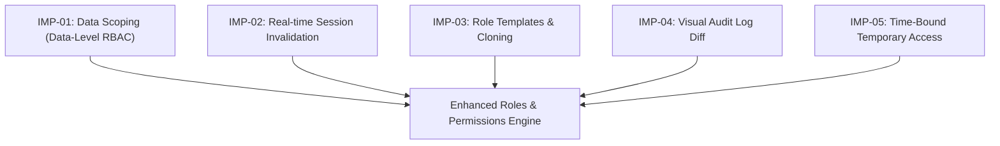

# Document History

| Version | Date | Author | Status | Changes |
| --- | --- | --- | --- | --- |
| 1.0 | October 5, 2026 | Team BA XPERC | Proposed | Initial creation of System Improvement Specification for Roles & Permissions |

---

# 1. Executive Summary & Rationale

## 1.1. Background & Context
The current **Roles & Permissions** module in the **XPERC License Management System** establishes a solid foundational Role-Based Access Control (RBAC) architecture with 28 granular action permissions across 8 functional categories. However, as the platform expands across multiple products (`xcorp.app`, `syrix.ai`), international markets, and multi-tier organizational structures, several operational bottlenecks and security gaps have emerged:
1. **Lack of Data-Level Scoping:** Action permissions are global. An Admin with `company.edit` can modify ALL companies regardless of customer segment, country, or tier.
2. **Delayed Permission Propagation:** Modifying an active role's permissions does not revoke access immediately for currently logged-in administrators until their JWT session expires.
3. **Repetitive Role Setup:** Admin managers lack the capability to clone existing custom roles or use pre-configured role templates, leading to manual errors when setting up similar roles.
4. **Opaque Audit Traceability:** Audit logs capture that a role was updated, but lack an intuitive visual diff to show exact permission changes (which permissions were added or removed).
5. **Rigid Access Lifecycles:** No mechanism exists for granting temporary, time-bound elevated access for emergency customer support or debugging.

## 1.2. Objective
This document details the functional specifications, business rules, UI designs, and technical constraints for **5 key architectural enhancements** to elevate the Roles & Permissions module to enterprise-grade security and usability standards.

---

# 2. Proposed Improvements & Detailed Specifications



---

## IMP-01: Data Scoping & Contextual Constraints (Data-Level RBAC)

### 1. Description
Extends the current action-based permission model (`[category].[action]`) by appending contextual **Data Scope Filters**. Administrators can define not only *what actions* a role can perform, but also *which specific subset of data* the role is authorized to operate upon.

### 2. Business Rules & Constraints
- **Scope Dimensions:**
  1. **Company Type Scope:** `All` | `External Only` | `Beta Only` | `Internal Only`.
  2. **Domain / Product Scope:** `All` | `xcorp.app Only` | `syrix.ai Only`.
  3. **Geographic / Region Scope:** `Global` | `VN (Vietnam)` | `US / Global`.
- **Evaluation Logic:**
  $$\text{Access Granted} \iff \text{Has Action Permission} \land \text{Target Data Matches Role Scope}$$
  *Example:* An Admin with `company.edit` scoped to `Company Type = Beta` will be allowed to edit Beta companies, but receive an `HTTP 403 Forbidden` if attempting to edit an External customer company.
- **Super Admin Protection:** The default `Super Admin` role is permanently set to `Scope = All / Global` and cannot be restricted.

### 3. Acceptance Criteria (BDD)
- **Scenario 1.1: Configure Data Scope during Role Creation**
  - **Given:** The Super Admin is on the "Create Role" Modal.
  - **When:** The Admin fills in Role Name "Beta Support Manager" and expands the "Data Scope Settings" section.
  - **Then:** The system displays dropdown selectors for Company Type, Product Domain, and Geographic Region.
  - **When:** The Admin selects `Company Type = Beta` and `Region = VN`, then saves the role.
  - **Then:** System persists the scope parameters in `scope_config` JSON column and logs the scope setup in Audit Trail.

- **Scenario 1.2: Server-Side Data Scope Enforcement**
  - **Given:** Admin User B is assigned the role "Beta Support Manager" (`Company Type = Beta`).
  - **When:** Admin User B attempts to access the detail page of Company XYZ (`Company Type = External`).
  - **Then:** The system intercepts the request, blocks data rendering, and displays an inline warning banner: *"Access Restricted: Your role scope is restricted to Beta Companies."*

---

## IMP-02: Real-Time Session & Token Invalidation (Active Revocation)

### 1. Description
Implements an active security revocation mechanism using WebSocket / Server-Sent Events (SSE) and a Redis Token Blacklist. When a role's permission matrix is modified or deleted, all active administrator sessions holding that role are updated or invalidated instantly without waiting for JWT token expiration.

### 2. Business Rules & Technical Pipeline
- **Event Bus Trigger:** Any mutation on `roles` or `role_permissions` tables emits a `ROLE_MUTATED_EVENT(role_id, timestamp, modified_by)`.
- **Revocation Actions:**
  - **Case A (Permissions Revoked):** If an active Admin is currently viewing a page whose `view` permission was just removed, the system immediately displays a security modal: *"Your permissions have been updated by an Administrator. Redirecting to Dashboard..."* and navigates them away within 3 seconds.
  - **Case B (Role Deleted):** Active sessions tied to the deleted role have their refresh tokens revoked in Redis, prompting an immediate logout redirect to `/login?reason=role_deleted`.

### 3. Acceptance Criteria (BDD)
- **Scenario 2.1: Immediate Enforcement of Permission Revocation**
  - **Given:** Admin User C is currently viewing the "Billing Management" page using the `Finance Viewer` role.
  - **When:** Super Admin edits the `Finance Viewer` role and unchecks `billing.view`.
  - **Then:** Within **< 1 second**, Admin User C's browser receives the SSE revocation payload.
  - **And:** The Billing UI is obscured by a security modal and automatically redirects Admin User C to the main Dashboard.

---

## IMP-03: Role Templates & Role Cloning Utility

### 1. Description
Accelerates administrative setup by providing pre-packaged **System Role Templates** for common operational job functions, alongside a single-click **"Duplicate / Clone Role"** utility on all existing role cards.

### 2. Business Rules
- **Built-in System Templates:**
  1. **Compliance Auditor:** Full `view` permissions across all 8 categories; zero `create/edit/delete` permissions.
  2. **Billing Operations:** Full access to `Billing Management` and `Company Management (View)`; read-only access to others.
  3. **Product Support Specialist:** Full access to `Module Management`, `License Management`, and `Company Management`.
- **Cloning Logic:** Clicking "Duplicate" on any role card opens the "Create Role" modal pre-populated with:
  - Role Name: `"Copy of [Original Role Name]"`
  - Description: `"Cloned from [Original Role Name] on [Date]"`
  - Permission Matrix: 100% exact copy of the source role's checkbox states.

### 3. Acceptance Criteria (BDD)
- **Scenario 3.1: Duplicate an Existing Custom Role**
  - **Given:** The Super Admin views the custom role card `Operations Manager` on the Dashboard.
  - **When:** Clicks the **"Duplicate" (Copy icon)** button on the card.
  - **Then:** The system opens the Create Role Modal pre-filled with Name `"Copy of Operations Manager"` and all 16 permissions pre-checked matching the parent role.
  - **When:** Admin changes the name to `"Junior Operations Manager"` and clicks Save.
  - **Then:** A new distinct role is created without modifying the parent role.

---

## IMP-04: Visual Audit Log Diff Viewer for Permission Changes

### 1. Description
Upgrades the Audit Log viewer to render intuitive, color-coded visual diffs for role modifications, replacing raw JSON string representations with human-readable permission delta badges.

### 2. UI & Functional Specification
- **Visual Diff Component:**
  - 🟢 **Green Tag (`+` Added):** Permissions enabled in the new version.
  - 🔴 **Red Tag (`-` Removed):** Permissions revoked in the new version.
  - ⚪ **Gray Text (Unchanged):** Summarized or hidden under a "Show Unchanged (22)" toggle.

```text
[Audit Log Detail Modal]
Action: EDIT_ROLE | Target: "Operations Manager" | Performed By: hanh.nguyen | Time: 2026-10-05 14:30

Permission Modifications:
  + [ADDED]   billing.view (View Billing)
  + [ADDED]   billing.edit (Edit Billing)
  - [REMOVED] user.delete  (Delete User)
```

---

## IMP-05: Time-Bound Temporary Access Elevation

### 1. Description
Enables Super Admins to assign temporary elevated roles or permission overrides to an Admin user with an automated expiration timer (e.g., granting `Super Admin` access for 4 hours to resolve a critical production incident).

### 2. Business Rules
- **Expiration Configuration:** When assigning a role to an admin, the Super Admin can set an optional **"Access Expiry"** date and time.
- **Automated Revocation:** A high-precision background timer / Cronjob evaluates active temp grants every minute. Upon reaching expiration, the system automatically revokes the temporary role, reverts the admin to their base role, and logs an Audit event: `TEMP_ACCESS_EXPIRED`.

---

# 3. UI Fields & Specification Matrix (Enhancements)

| Field Name | UI Component | Data Type | Mandatory | Default | Constraints & Business Logic |
| --- | --- | --- | --- | --- | --- |
| **Company Type Scope** | Multi-Select Dropdown | Enum List | Yes | `All` | Options: `All`, `External`, `Beta`, `Internal`. |
| **Product Domain Scope** | Multi-Select Dropdown | Enum List | Yes | `All` | Options: `All`, `xcorp.app`, `syrix.ai`. |
| **Region Scope** | Dropdown | Enum | Yes | `Global` | Options: `Global`, `VN`, `US`. |
| **Temporary Access Toggle** | Switch Toggle | Boolean | No | `Off` | Enables time-bound role assignment. |
| **Access Expiration Time** | DateTime Picker | ISO Timestamp | Conditional | `Null` | Required if Temporary Access Toggle is `On`. Must be in future. |

---

# 4. Impact Analysis & Database Schema Migrations

## 4.1. Schema Changes (`roles` & `admin_roles` tables)
```sql
-- Add Data Scoping JSON configuration column to roles table
ALTER TABLE roles ADD COLUMN scope_config JSONB DEFAULT '{"company_type": ["ALL"], "domain": ["ALL"], "region": "GLOBAL"}';

-- Add Template flag to roles table
ALTER TABLE roles ADD COLUMN is_template BOOLEAN DEFAULT FALSE;

-- Add Expiration Timestamp to admin_roles junction table for Time-Bound access
ALTER TABLE admin_roles ADD COLUMN expires_at TIMESTAMP WITH TIME ZONE DEFAULT NULL;
```

## 4.2. Performance SLA
- Data Scope evaluation overhead MUST be under **< 15ms** per API request.
- Real-time SSE revocation broadcast latency MUST be under **< 500ms** from database commit.

---

# 5. Implementation Roadmap & Priority

| Feature ID | Feature Name | Priority | Estimated Complexity | Target Release |
| --- | --- | --- | --- | --- |
| **IMP-01** | Data Scoping (Data-Level RBAC) | **High (P1)** | High | Sprint Q4-1 |
| **IMP-02** | Real-time Session & Token Invalidation | **High (P1)** | Medium | Sprint Q4-1 |
| **IMP-03** | Role Templates & Role Cloning Utility | **Medium (P2)** | Low | Sprint Q4-2 |
| **IMP-04** | Visual Audit Log Diff Viewer | **Medium (P2)** | Low | Sprint Q4-2 |
| **IMP-05** | Time-Bound Temporary Access | **Low (P3)** | Medium | Sprint Q1-1 |
